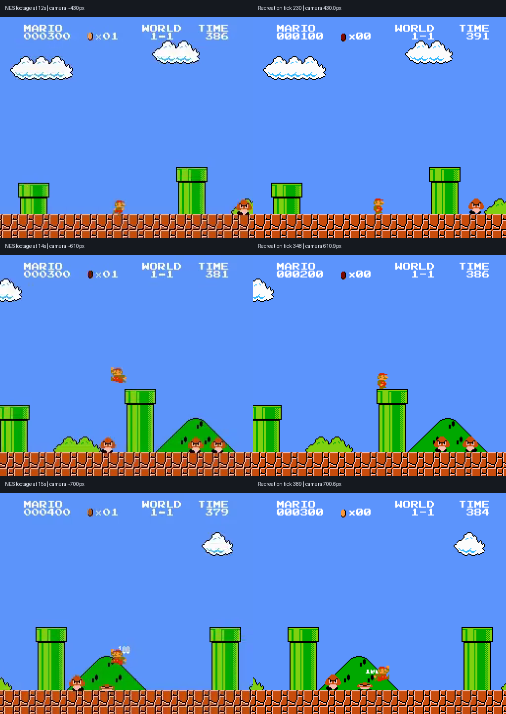
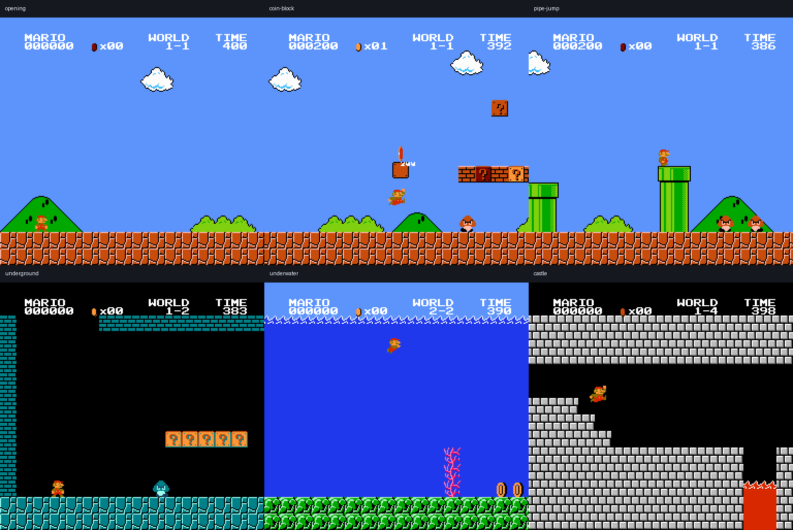

# Validation report

Validated locally on macOS arm64, 2026-11-20. The target is recognizable, playable NES Super Mario Bros. with reliable synthetic-data generation. Small visual/timing differences are acceptable; cycle accuracy is not a release criterion.

## Results

| Check | Result | Evidence |
|---|---|---|
| Behavioral tests | 39 passed | `tests/test_environment.py` |
| Stage coverage | All 32 stages load and advance | Parameterized tests |
| Longer stage smoke runs | 10,001 total ticks, no crashes across 32 stages | [stage-smoke.json](stage-smoke.json) |
| Sanitizer regression checks | 3 passed with address/undefined-behavior sanitizers | Seeded replay, coin-block interaction, flying-fish callback regression |
| Earlier sanitizer scenarios | Seven stage scenarios completed without sanitizer errors | 1-1, 1-2, 1-3, 1-4, 2-2, 4-1, 8-4; 95–350 ticks each |
| Dataset replay | 344 + 449 observations matched exactly | Local `datasets/verified/` episodes; PNG SHA-256 and full JSON state checked |
| Interactive launch | Native SDL window stayed running through intro | Four-second launch smoke test, no stderr output |
| Opening scenery | 50,944 / 50,944 checked pixels match reference map | [metrics.json](metrics.json), [comparison](opening-comparison.png) |

The stage smoke policy holds right/run and pulses jump for up to 600 ticks, stopping on death. A normal death is not a failed test. These runs exercise gameplay but do **not** establish that every stage has been played to completion. The interactive launch check is not a manual playthrough.

## Screenshots versus real footage

The left column contains frames extracted from [HappyLee's archived NES walkathon recording](https://archive.org/details/supermariobros_walkathonv3_happylee), at 12, 14, and 15 seconds. The right column contains captures from running this recreation through the corresponding World 1-1 locations. Camera positions were matched approximately by comparing terrain silhouettes against the reference map. The recorded inputs differ, so Mario's pose, enemy positions, score, and timer are not expected to match at these locations.

The footage is 256×224, with the top and bottom eight rows removed by its encoder. The comparison crops recreation frames the same way; **training observations remain 256×240**. Its palette/video compression differs slightly from the uncompressed game assets.

Visual inspection confirmed the characteristic sprites, tile scale, ground line, pipes, clouds/hills, block arrangement, and scrolling composition in these scenes. It also found and led to fixes for the viewport width, undersized HUD text, fractional-pixel sprite rendering, and an opening-cloud placement error. The reference capture near 15 seconds also helped identify an over-applied cloud correction, which was reverted outside the opening cloud.

These include the opening, a coin-block hit, pipes, the underground stage, swimming, and a castle. Individual PNGs and their actual player/camera state are in [screenshots/](screenshots/) and [capture-states.json](capture-states.json). No debug overlays are drawn into gameplay observations.

## Exact static comparison scope

The opening's static scene was compared against [NESMaps' World 1-1 map](https://www.nesmaps.com/maps/SuperMarioBrothers/SuperMarioBrosWorld1-1MapBG.html). The top 40 rows were excluded because the map has no HUD; Mario's 16×16 rectangle was excluded because the map has no player. All remaining 50,944 pixels match exactly. This is evidence for **one scene's static scenery and palette**, not a percentage score for whole-game fidelity.

Run `python tools/validate_visuals.py` from the project folder to recreate screenshots, comparisons, and the static metric from the retained reference PNGs.

## Gameplay and data checks

Tests cover seeded process resets, identical actions producing identical state/pixels, acceleration and walk/run speed limits, release friction, variable jump height, no mid-air double jump, landing, coin-block scoring, death termination, time-limit truncation, input validation, and all stage loads.

A longer run found a genuine use-after-free in World 2-3: a flying fish's delayed callback captured its timer closure by reference, then executed after the fish was stomped and the timer removed. The fix captures by value and cancels the pending launch when the fish dies. Callback dispatch also now owns its callable while components remove/replace themselves. The specific failing action sequence is retained as a regression test and passed under AddressSanitizer.

Other stability changes include synchronous map construction, safe iteration when callbacks create entities/commands, deduplicated entity destruction, and replacing components without accumulating inaccessible old instances. Episode resets use a fresh process so global timers, queued commands, and random state cannot leak between runs.

## Remaining differences and limits

- This is a C++ collision/physics recreation, not a 6502/PPU emulator. Movement uses the original numeric speed/jump tables as guidance, but collision ordering, some acceleration transitions, animation timing, and enemy activation are approximate.
- The timer advances at 60 simulation ticks/second. Exact NTSC refresh, the original frame-rule behavior, hardware sprite limits, and speedrunning glitches are not reproduced.
- Stage layouts and mechanics come from the upstream recreation. Full-game route completion, every secret, and every enemy/power-up interaction have not been exhaustively certified.
- HUD glyphs, some effects, score-chain details, and sampled audio can differ slightly. Audio is playable but is not recorded as training data.
- Identical replay is verified on this build/platform. Cross-platform floating-point/renderer identity is not guaranteed.
- The supplied collector is exploratory, not an expert Mario player. It produces real deaths and truncations with explicit labels; change the policy for longer or more diverse trajectories.

These limitations are retained in dataset metadata so synthetic data is not mistaken for original-emulator ground truth.
